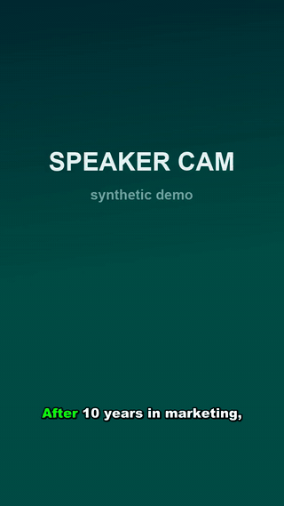
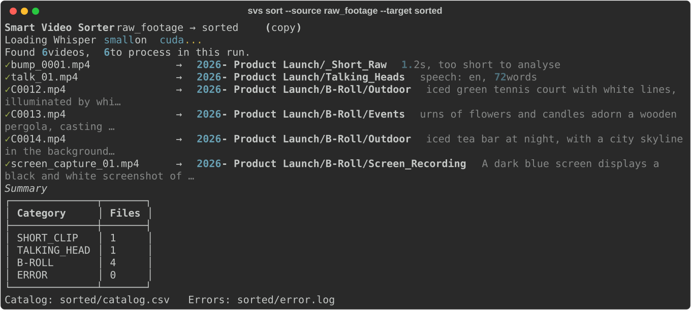
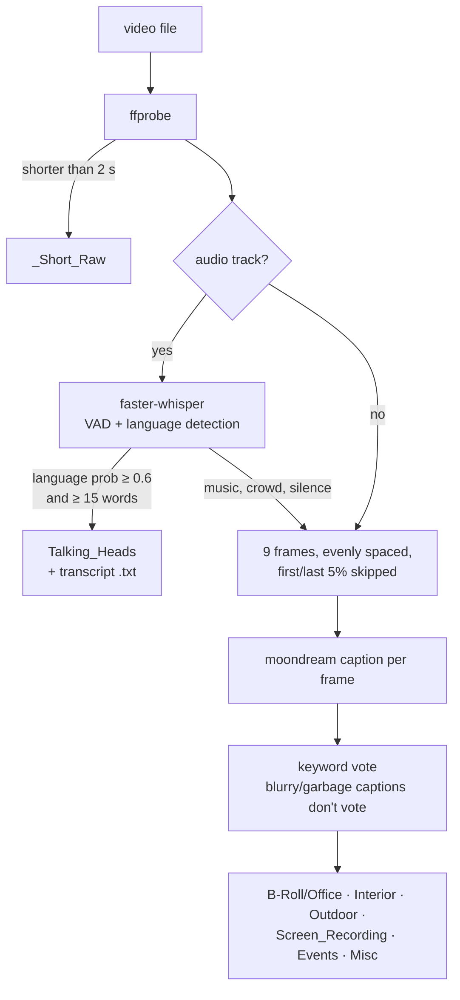

# Smart Video Sorter

**From a drive full of raw event footage to sorted folders, a searchable catalog and captioned vertical shorts. Runs 100% locally.**

<p align="center">
  
</p>

Event and corporate videographers end every job with hundreds of unnamed clips (`00013.MTS`, `C0012.MP4`...) spread over cards, cameras and network drives. Finding "the clip where the speaker talks about profit" means scrubbing through hours of footage.

`svs` does the first pass for you:

1. **Sorts** every clip into *Talking heads* (real speech, detected with Whisper), *B-roll* (classified by a local vision model) or *too-short fragments*, grouped by event.
2. **Transcribes** talking heads and stores the transcript next to the file.
3. **Scores highlights** (questions, exclamations, topic keywords) and **cuts shorts** of 15-60 s around them.
4. **Renders vertical 9:16 shorts** with word-by-word karaoke captions, a face-aware crop, a light grade and an optional whoosh SFX.

Everything runs on your machine: [faster-whisper](https://github.com/SYSTRAN/faster-whisper) for speech, [Ollama](https://ollama.com) + `moondream` for vision, FFmpeg for media. No uploads, no API bills.

<p align="center">
  
</p>

## How it decides



Design choices that matter on real archives:

- **Small vision models are bad at "pick one label" prompts** (moondream often returns nothing), but good at captions. So `svs` asks for a one-sentence caption per frame and maps keywords to categories in Python. Captions from dark or blurry frames do not vote, and degenerate loops (`reserve/reserve/reserve...`) are discarded, so a few bad frames cannot drown out the good ones.
- **Resumable by design.** Every file gets a row in `video_catalog.db`. Stop at any time, rerun the same command, and only unprocessed files are touched. `--batch-size N` processes a slice per run.
- **Network-drive tolerant.** ffmpeg first reads straight from the share (NAS, WebDAV-mapped drive). If a read times out, that one file is copied to local temp once and every later step reuses the copy.
- **Never overwrites.** Name clashes become `clip_1.mp4`, `clip_2.mp4`. Default action is `copy`; `--dry-run` only logs.
- **One bad file never kills a 1,000-file run.** Errors are recorded in the catalog and `error.log`, and the run continues.

## Install

Requirements: Python 3.10+, FFmpeg on your PATH, [Ollama](https://ollama.com) running locally. A CUDA GPU is optional but makes Whisper much faster.

```bash
pip install -e .            # installs the `svs` command
ollama pull moondream
```

## Usage

```bash
# 1. sort: talking heads / B-roll / short fragments, grouped by event folder
svs sort --source "Z:/Raw Footage" --target sorted --device cuda

# 2. find clip-worthy moments in every talking head
svs highlights --target sorted

# 3. cut them into 15-60 s shorts (stream copy; add --accurate for frame-exact cuts)
svs shorts --target sorted

# 4. turn one into a vertical short with karaoke captions
svs caption "sorted/2026 - Product Launch/Shorts/talk_01_short01_It_is_the_strategy.mp4" --language en

# watch a long run from a second terminal
svs monitor --target sorted
```

What you get:

```
sorted/
├── 2026 - Product Launch/
│   ├── Talking_Heads/      talk_01.mp4 + talk_01.txt (transcript)
│   ├── B-Roll/
│   │   ├── Outdoor/        C0012.mp4, C0014.mp4
│   │   ├── Events/         C0013.mp4
│   │   └── Screen_Recording/
│   ├── Shorts/             talk_01_short01_It_is_the_strategy_behind....mp4 ...
│   └── _Short_Raw/         bump_0001.mp4
├── catalog.csv             one row per clip: event, category, duration, language, words, visual description
├── shorts_manifest.csv     every short with its timestamps, score, reason and quote
├── video_catalog.db        resume state (SQLite)
└── error.log
```

### All commands

| command | what it does |
|---|---|
| `svs sort` | probe → speech check → vision vote → copy/move into `<event>/<category>/`, writes `catalog.csv` |
| `svs highlights` | re-transcribes talking heads and stores the top 10 scored moments per clip |
| `svs shorts` | cuts every stored highlight into `<event>/Shorts/`, widened to 15-60 s and padded so words are not clipped |
| `svs caption <clip>` | 9:16 render: Haar face detection picks the crop, Whisper word timestamps drive the ASS karaoke captions, `eq` grade, optional `--sfx`, fade-out |
| `svs broll-events` | for conference/gala archives: re-buckets B-roll into *Stage, Audience, Networking, Awards, Decor*. `--reverse` lets a second worker drain the queue from the other end |
| `svs watch` | runs jobs dropped into `task.json` (catalog a folder with OCR on flyers, or score highlights) and writes `response.json`, so other tools and agents can drive it |
| `svs monitor` | live dashboard: highlights progress, event B-roll progress, shorts cut, files per category, GPU load |

Useful options: `--event-depth 2` when your tree is `<operator>/<event>/...`; `--keywords words.txt` to score highlights on your own topics; `--fix crayova=Craiova` to correct names Whisper keeps mishearing in captions; `--vision-model llava` to use a different Ollama model.

## Demo footage

The GIF and the output above come from a real run of this repo on **synthetic footage**: a text-to-speech voice over a gradient (the "talking head"), Ken Burns pans over still images (B-roll), a scrolled website capture and a 1.2 s black clip. No real people are shown.

On that set, `svs sort` placed all 6 clips correctly, `svs highlights` found 5 moments (2 keyword-heavy sentences, 1 question, 2 single-keyword lines) and `svs shorts` cut all 5.

## Tests

```bash
pip install -e ".[dev]"
pytest -q
```

The tests cover the pure logic: event naming, highlight scoring, the 15-60 s window maths, caption chunking and ASS output, vision caption mapping, event shot types, catalog resume and CSV export.

## Project layout

```
svs/
  cli.py          Typer CLI, one command per stage
  sorter.py       main sort pass
  ffmpeg_utils.py ffprobe/ffmpeg wrappers with network-drive fallback
  transcribe.py   faster-whisper engine, highlight scoring
  vision.py       Ollama vision client, caption cleaning, keyword vote
  catalog.py      SQLite catalog, event naming, safe file placement, CSV exports
  highlights.py   highlight pass
  shorts.py       short cutting + manifest
  captions.py     vertical render: face crop, karaoke ASS, grade, SFX
  broll.py        event shot-type pass
  watcher.py      task.json job runner (+ OCR cataloguing)
  monitor.py      Rich live dashboard
```

## License

MIT
